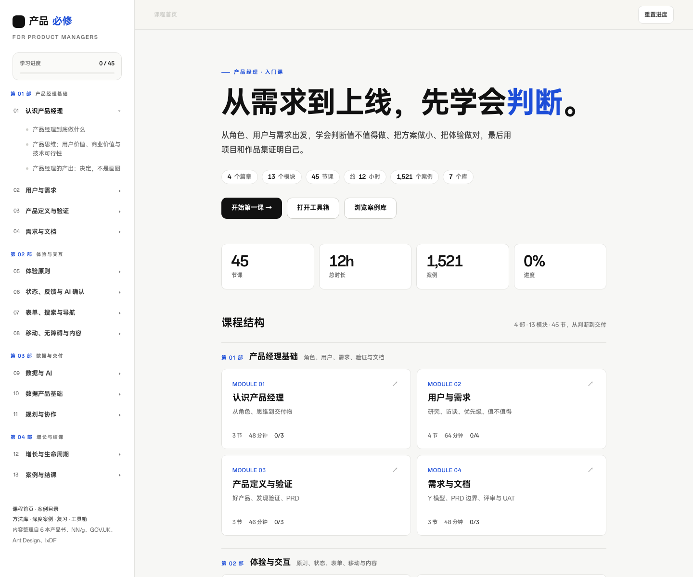

# 产品经理入门课



一套可直接打开的 HTML 课程：**4 部、13 个模块、45 节课，每节 2,200–3,000 字**（全书约 11.3 万字），从角色与用户需求，到体验设计、数据指标、规划协作与求职作品集。配套 1,521 条案例目录、55 张方法卡、18 个带证据等级的深度案例、间隔复习与交付模板。

## 打开方式

**推荐**：起一个本地服务器，进度与测验答案会保存在浏览器里。

```bash
cd pm-interaction-course
python3 -m http.server 8080
# 浏览器打开 http://localhost:8080
```

也可以直接双击 `index.html`（file:// 打开）。功能都能用，但部分浏览器会禁用 file:// 下的 localStorage，进度可能刷新即丢——页面左下角会有提示。

## 课程结构

课程分 **4 部 / 13 模块 / 45 节**：

| 篇章 | 模块 | 主题 |
|---|---|---|
| **第一部 产品经理基础** | 01 认识产品经理 | PM 的三类责任与边界、产品思维、交付物 |
| | 02 用户与需求 | 用户研究、访谈与需求翻译、需求优先级、值不值得做 |
| | 03 产品定义与验证 | 什么叫好产品、发现与三类验证、PRD 与验收 |
| | 04 需求与文档 | Y 模型、PRD 边界与分支、需求评审/变更/UAT |
| **第二部 体验与交互** | 05 体验原则 | 成本、心智、两道鸿沟、复杂度、可逆性、迁移成本 |
| | 06 状态与反馈 | 五态、异步矩阵、反馈强度、错误文案、AI 决策确认 |
| | 07 表单、搜索与导航 | 字段与校验、搜索、筛选、信息架构 |
| | 08 移动、无障碍与内容 | 触控与手势、键盘焦点、对比度、内容版式 |
| **第三部 数据与交付** | 09 数据与 AI | 指标、数据叙事、AI 界面、实验与 A/B |
| | 10 数据产品基础 | 指标口径与平台、埋点与质量、数据界面权限 |
| | 11 规划与协作 | 路线图与资源、敏捷与评审、上线与发布 |
| **第四部 增长与结课** | 12 增长与生命周期 | AARRR 与留存、PMF、生命周期与跨越鸿沟 |
| | 13 案例与结课 | 案例读法、结课项目、作品集与面试 |

每节结构：学习目标 → 先判断 → 为什么重要 → 判断表/步骤 → 案例与反例 → 练习（带评分标准）→ 随堂测验 → 合上写。工具箱含交互规格生成器、高风险自检 10 项与走查报告骨架。

## 交互功能

- **学习进度**：标记完成、侧边栏进度条、模块完成角标（localStorage）
- **随堂测验**：即时判分、干扰项解释、答错可重试；有测验的课必须先答对才能完成
- **先判断 / 合上写**：先回忆再看解释（检索练习）
- **间隔复习**：完成课后按 1/3/7/14 天到期；错题 3 天后重做
- **方法库 / 深度案例**：55 张方法卡、18 个带证据等级的案例，可搜索筛选
- **案例目录**：1,521 条，按来源与标签筛选、分批加载
- **工具箱**：规格生成器（含边界/分支与非功能字段）、高风险自检、走查骨架

内容侧共 **45 道随堂测验**、**44 个先判断**、**45 个合上写**、**45 个练习（全部带评分标准）**；每节至少一张判断表、一个案例或反例、一份可判分练习。

## 设计

- **风格**：Swiss / 极简（网格、单一强调色、硬边卡片、无渐变），由 UI/UX Pro Max 的样式库检索选定后收敛。
- **字体**：全站 OPPO Sans（Regular / Medium / Bold，WOFF2，随包分发）。
- **可访问性**：可见焦点环、`prefers-reduced-motion` 降级、375 / 768 / 1024 / 1440 均无横向滚动、触控目标放大。
- **图标**：内联 SVG，不用 emoji。

## 文件

```
index.html       应用外壳
styles.css       设计系统与样式
data.js          课程数据（11 模块 38 节）
cases-data.js    案例目录（1,521 条）
data-research.js 方法库与深度案例
app.js           路由、渲染、进度、测验、搜索、复制
fonts/           OPPO Sans（WOFF2）
preview.png      首页预览
```

课程内容由 `tools/restructure_course.js` 重组生成；案例目录由 `tools/fetch_cases.py`、方法库由 `tools/build_research_data.py` 生成。

## 内容来源

- NN/g 交互设计主题与 Web UX 指南（`../01-`、`../02-`）
- GOV.UK Design System 与用户研究（`../03-`、`../04-`）
- Ant Design 规范（`../05-`）、IxDF 主题（`../06-`）
- 六本产品书精读蒸馏（`../research/books/`）
- 案例库：Page Flows、Growth.Design、The Pudding、Siteinspire、Design Spells、SND

字体 OPPO Sans 由 OPPO 免费开放使用（含商用）；对外发布请保留署名并遵守官方说明。
